<div align="center">

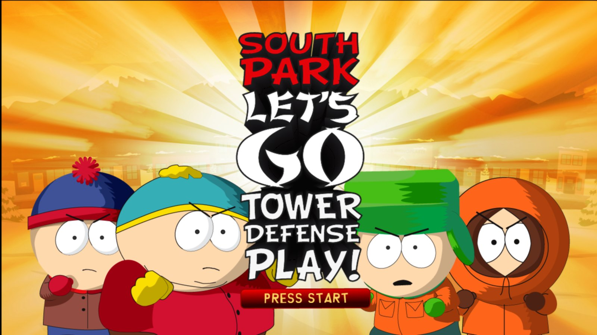

### South Park: Let's Go Tower Defense Play! on PC, running natively, with a launcher and the options of a modern PC release.

[](https://github.com/TekRantGaming/south-park-tower-defense-recompiled/releases/latest)
&nbsp;
[](https://github.com/TekRantGaming/south-park-tower-defense-recompiled/releases/latest)

[](https://github.com/TekRantGaming/south-park-tower-defense-recompiled/releases/latest)
[](https://github.com/TekRantGaming/south-park-tower-defense-recompiled/releases)


<br>

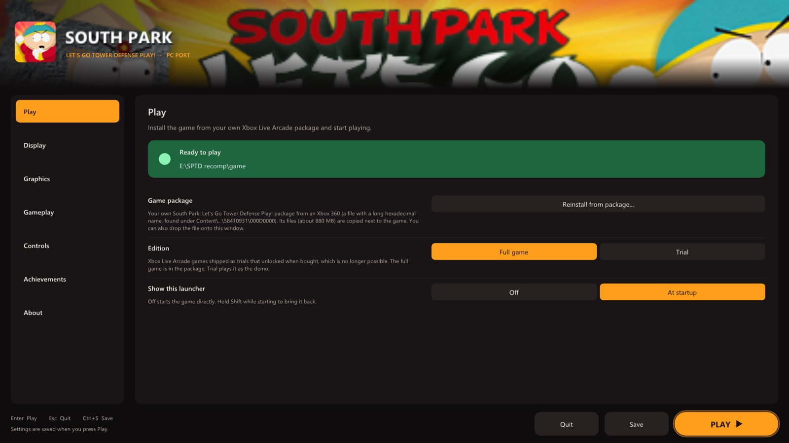

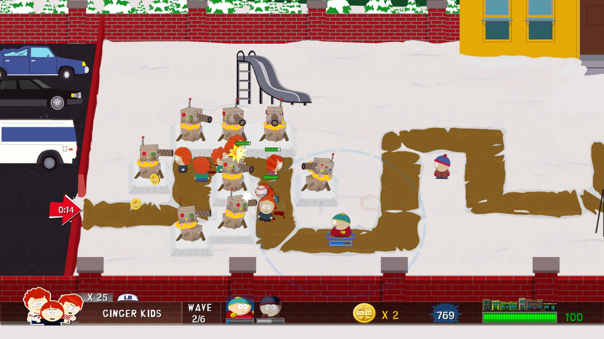
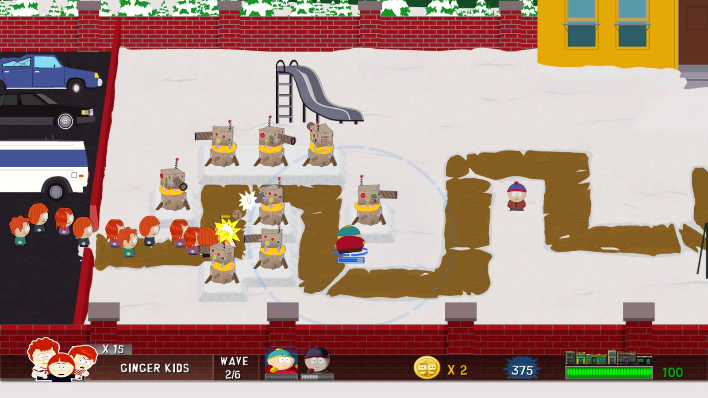
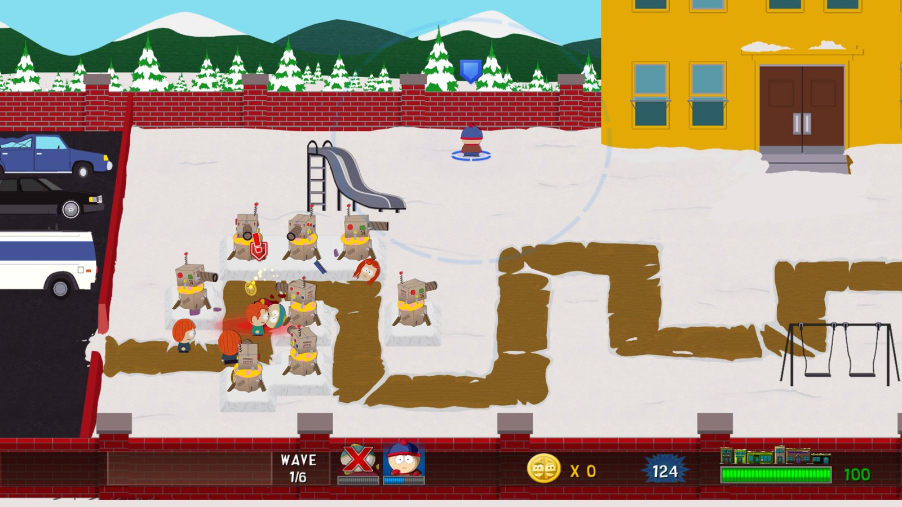
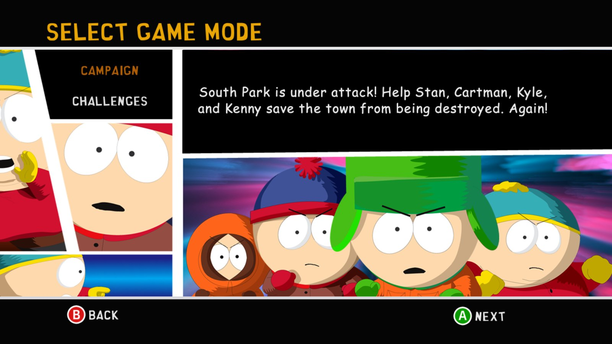

<sub>The original Xbox 360 game code, translated to native PC code with the <a href="https://github.com/rexglue/rexglue-sdk">ReXGlue SDK</a>. <b>No game files included</b>: bring your own South Park: Let's Go Tower Defense Play! Xbox Live Arcade package.</sub>

</div>

<br>

## At a glance

| | | |
| :--- | :--- | :--- |
| 🖥️ **Native Windows and Linux** builds, no emulator | 🎮 **Any controller**, or the keyboard with your own bindings | 🗂️ **Saves and settings** one click away in the launcher |
| ✨ **Up to 8K**, FXAA, MSAA and 16x texture filtering | ⏱️ **The console's 60 FPS**, paced exactly like the Xbox 360 | 🔁 **Remap any button**, deadzone, vibration strength |
| 🏆 **Achievements** with Xbox 360-style pop-ups | 📦 **Install from your own package** in a few clicks | 🔄 **Updates itself** from this page |
| 🐧 **Linux and Steam Deck** as a single AppImage | 🌍 **Six languages**: English, French, German, Spanish, Italian, Japanese | 🪟 **Windowed or fullscreen**, any monitor, F11 to switch |

<div align="center">

## The launcher

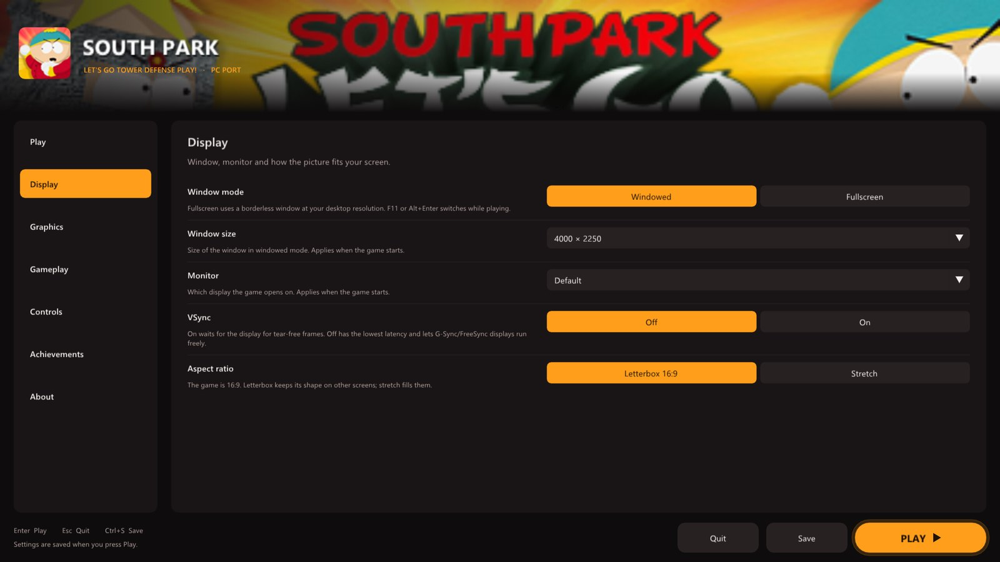
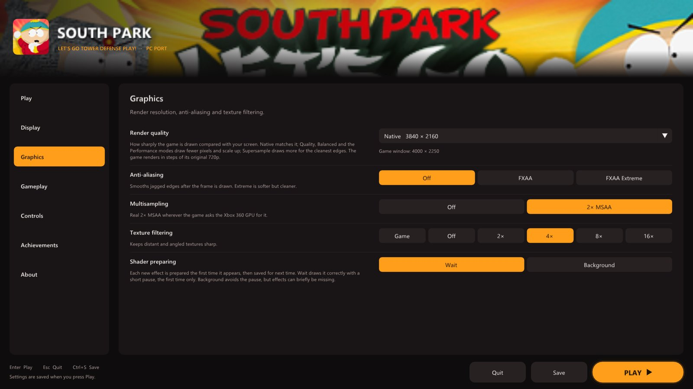
<sub><b>Display</b>: window, monitor, VSync, aspect ratio &nbsp;·&nbsp; <b>Graphics</b>: render resolution, anti-aliasing, filtering</sub>

<br><br>

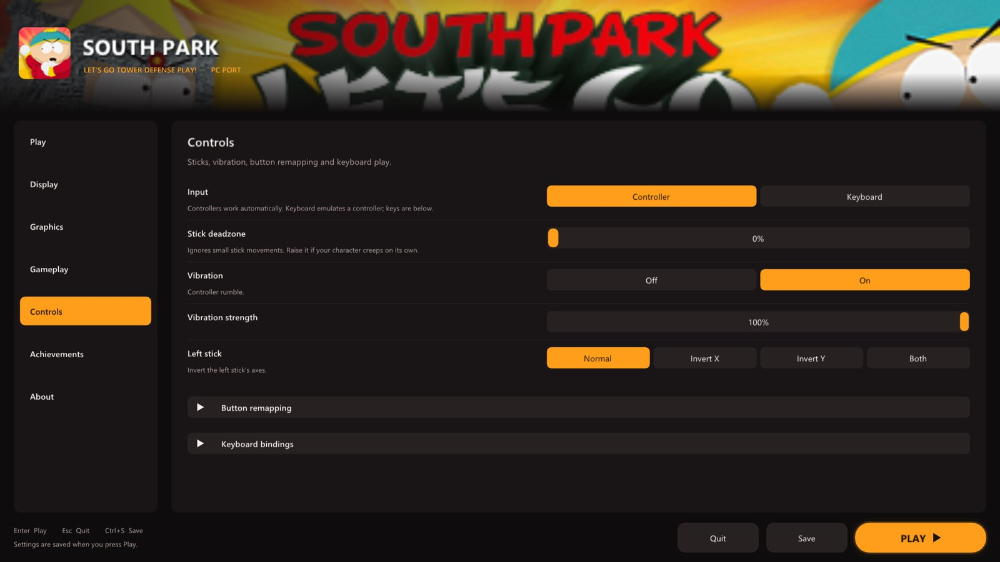
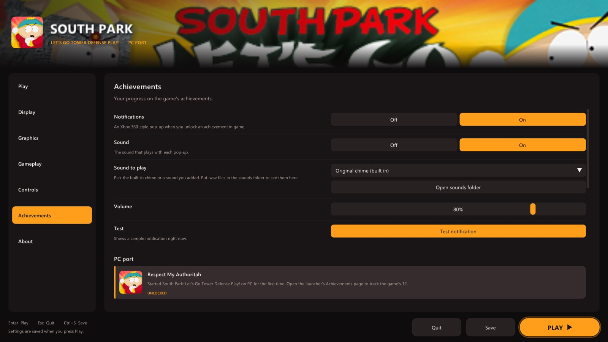
<sub><b>Controls</b>: remapping, deadzone, vibration, keyboard &nbsp;·&nbsp; <b>Achievements</b>: the game's 12, with pop-ups and sound</sub>

</div>

<br>

> [!NOTE]
> **Early version.** The port boots, plays its movies and runs levels on Windows and Linux, but a full play-through hasn't been confirmed yet. Please [report anything that goes wrong](#reporting-a-problem). What changed in each version is on the [releases page](https://github.com/TekRantGaming/south-park-tower-defense-recompiled/releases).

## Getting started

**You need:** Windows 10 or 11 (64-bit) and a DirectX 12 graphics card, **or** 64-bit Linux / a Steam Deck with Vulkan; about 1 GB of free space; and your own South Park: Let's Go Tower Defense Play! Xbox Live Arcade package (see [Which version you need](#which-version-you-need)).

### Windows

1. Download **SouthParkTD-...-windows-x64.zip** from the [latest release](https://github.com/TekRantGaming/south-park-tower-defense-recompiled/releases/latest) and unzip it anywhere.
2. Run **south_park_td.exe**. The launcher opens.
3. On the **Play** page click **Install from package...** and pick your package file (or drop it onto the window). Its files (about 880 MB) are copied into a `game` folder next to the exe.
4. Press **PLAY**.

### Linux and Steam Deck

1. Download **SouthParkTD-...-linux-x86_64.AppImage** from the [latest release](https://github.com/TekRantGaming/south-park-tower-defense-recompiled/releases/latest).
2. Make it executable: right-click > **Properties** > **Permissions** > **Is executable** (on a Steam Deck, in Desktop Mode), or `chmod +x` it.
3. Run it and install from your package as on Windows. The game files go in a `game` folder next to the AppImage.
4. On a Steam Deck, add it to Steam with **Games > Add a Non-Steam Game** and play it from Game Mode. **Start** presses Play in the launcher.

The download contains only this port. **No game files are included**: they come from your own package. Saves go in `Documents\south_park_td` on Windows (the launcher's **About** page opens the save folder on any system); settings are saved to `south_park_td.toml` next to the program.

### Which version you need

The port is made for this release only. Other versions, and title updates, will not work.

| | |
| --- | --- |
| Game | South Park: Let's Go Tower Defense Play! (Xbox Live Arcade, 2009) |
| Title ID | `58410931` |
| Content type | `000D0000` (Xbox Live Arcade) |
| Where it is on an Xbox 360 drive | `Content\0000000000000000\58410931\000D0000\` |
| Package | a `LIVE` file with a long hexadecimal name, about 925 MB |
| Game version | `default.xex` version **0.0.1.2**, built 2009-09-09 |
| `default.xex` | 8,499,200 bytes, CRC32 `A21E2AF7`, SHA-1 `6847374F5B8D1C1374AB08D08C81665168060E22` |

The launcher checks the title ID when you pick the package, and checks `default.xex` after installing. The package file's own checksum differs from player to player (its header carries the owner's licence), so `default.xex` is what identifies the version.

## The launcher

Everything is set up before the game starts, with a controller, the keyboard or the mouse. It uses art from your own copy of the game: the package's banner and icon, and the title screen once you have played. Settings are saved to a plain text file, `south_park_td.toml`, next to the game.

<table>
<tr>
<td width="55%"></td>
<td valign="middle">

### Play
- **Install from your XBLA package**, with the title ID and game version checked
- **Full game or Trial**: XBLA games shipped as trials unlocked by buying them; the full game is on by default
- Show the launcher at startup, or not (**hold Shift** at start to bring it back)

</td>
</tr>
<tr>
<td valign="middle">

### Display
- **Windowed** or **fullscreen**; <kbd>F11</kbd> or <kbd>Alt</kbd>+<kbd>Enter</kbd> switches while playing
- **Window size** that fits your screen, and **which monitor**
- **VSync** on or off
- **Letterbox 16:9** or **stretch** to fill

</td>
<td width="55%"></td>
</tr>
<tr>
<td></td>
<td valign="middle">

### Graphics
- **Render quality**: Native, Quality, Balanced, Performance and Ultra Performance, or **Supersample** for the cleanest edges
- **Custom resolution** from 1x (720p) to 6x (8K)
- **FXAA**, real **2x MSAA** and **texture filtering** up to 16x
- **Shader preparing**: wait for each new effect the first time (no missing objects), or prepare it in the background

</td>
</tr>
<tr>
<td valign="middle">

### Gameplay
- **Language**: English, French, German, Spanish, Italian or Japanese
- **Frame counter** in the corner, toggled with <kbd>F2</kbd>

The game runs one step per frame at the console's 60 Hz, so there is deliberately no frame-rate setting: a higher rate would only make it run fast.

</td>
<td>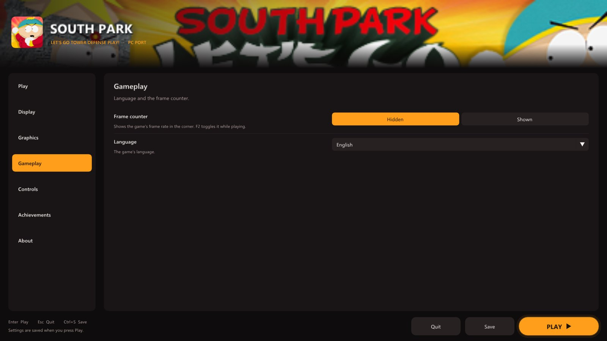</td>
</tr>
<tr>
<td></td>
<td valign="middle">

### Controls
- **Controller or keyboard**, with every keyboard binding changeable
- **Stick deadzone**, **vibration** on or off and its strength
- **Invert** the left stick's axes
- **Remap any button** on your controller

</td>
</tr>
<tr>
<td valign="middle">

### Achievements
- All **12 achievements** with their own pictures, names and gamerscore, read from your copy of the game
- See which ones you have **unlocked**
- Xbox 360-style **pop-ups** with a **sound** you can pick (or your own `.wav`) and its volume
- A bonus **Respect My Authoritah** achievement the first time you play

</td>
<td></td>
</tr>
<tr>
<td>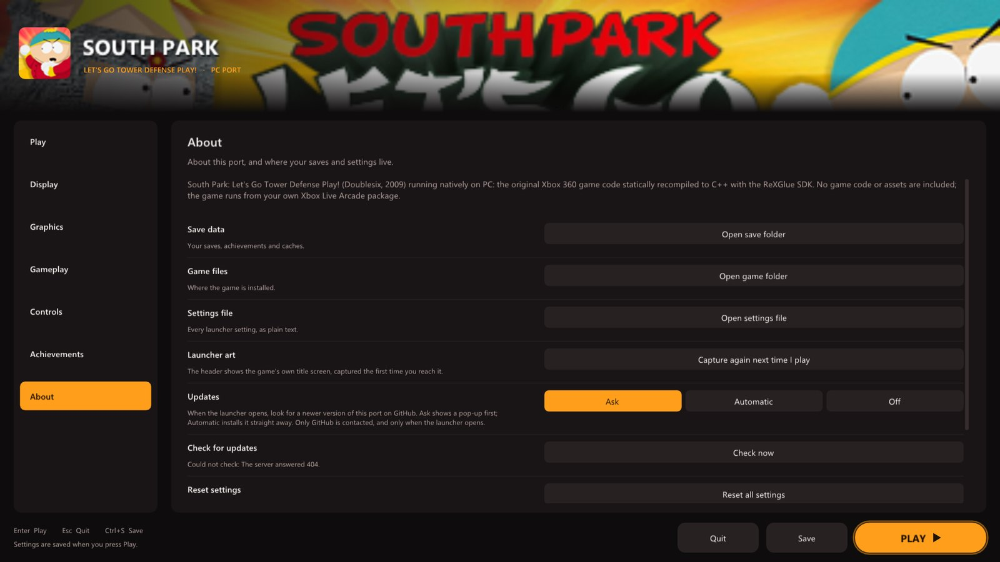</td>
<td valign="middle">

### About
- **Updates**: ask, automatic or off, and **Check now**
- Open your **save folder**, **game folder** or **settings file** in one click
- Capture the launcher's **title-screen art** again, or **reset** every setting

</td>
</tr>
</table>

## Xbox 360 vs PC port

| | Xbox 360 | PC port |
| --- | :---: | :---: |
| Resolution | 1280 x 720 | up to 7680 x 4320 |
| Frame rate | 60 fps | 60 fps, paced like the console |
| Anti-aliasing | console | FXAA, 2x MSAA, supersampling |
| Texture filtering | console | up to 16x |
| Display | TV | windowed or fullscreen, any monitor |
| Controls | Xbox 360 controller | any controller, remapping, keyboard |
| Achievement pop-ups | console | Xbox 360 style, with your choice of sound |

## Good to know

### Hotkeys

| Key | Action |
| --- | --- |
| <kbd>F2</kbd> | frame counter |
| <kbd>F3</kbd> | performance overlay |
| <kbd>F11</kbd> or <kbd>Alt</kbd>+<kbd>Enter</kbd> | fullscreen / windowed |
| <kbd>Shift</kbd> while starting | open the launcher |

### Known issues

- **Xbox LIVE game** (online play) does not work. Local play does.
- On the game-mode screen, the locked **HARD** difficulty is drawn with garbled letters.
- The first time you see a new effect it has to be prepared, which can cause a short pause. Effects are saved, so this only happens once.

### Updates

When the launcher opens it asks GitHub whether a newer version of the port is out, and offers to install it. **Update now** downloads it, replaces the port's own files and restarts the launcher; your installed game, saves and settings stay as they are. Change this on the **About** page (Ask, Automatic or Off).

### Reporting a problem

Everything useful is in the `logs` folder next to the program:

- `south_park_td.log` describes your settings, and every 10 seconds notes the frame rate, the 1% low and any frames that took over 50 or 100 ms.
- If the game crashes on Windows, `crash-<date>.txt` and `crash-<date>.dmp` appear next to it.

Please attach them to an [issue](https://github.com/TekRantGaming/south-park-tower-defense-recompiled/issues) together with your CPU, graphics card and operating system.

## About the port

*South Park: Let's Go Tower Defense Play!* came out on Xbox Live Arcade in 2009. Stan, Kyle, Cartman and Kenny defend South Park from waves of enemies by throwing snowballs, building towers and calling in the town's other kids. It was never released on PC.

This port translates the Xbox 360 game's own code to C++ ahead of time and runs it natively on Windows and Linux with the ReXGlue SDK. [NOTES.md](NOTES.md) has the technical details.

### The title-screen crash

Run as-is, the game crashes a few seconds after the title screen whenever a controller is connected. At start-up it reads its save data from the player's profile. For a profile that has never saved, the runtime answered "no value", where the console answers "default". The game took that as a corrupt save, marked the player as failed, and then crashed looking the player up. This port answers as the console does (`sptd/src/profile_fix.cpp`). Existing saves are untouched.

<details>
<summary><b>Building from source (for developers)</b></summary>

You need Visual Studio 2022 Build Tools with Clang, CMake and Ninja, and your own package.

```powershell
git clone --recursive https://github.com/TekRantGaming/south-park-tower-defense-recompiled
cd south-park-tower-defense-recompiled
.\setup.ps1 -Package "<path to your 58410931 package>"   # downloads the SDK, unpacks your package, translates the code
sptd\build.bat sptd-release                               # compiles
.\tools\package_windows.ps1 -Version v0.1.0               # optional: the release zip
```

The finished game is in `sptd\out\build\sptd-release`. Point it at your files with `--game_data_root`, or keep them in a `game` folder next to the exe. The Linux AppImage is built in WSL (Ubuntu 24.04) or on Linux after `setup.ps1`: `tools/build_appimage.sh v0.1.0`.

For testing, `sptd\build.bat sptd-dev` adds developer tracing hooks, `--sptd_null_trace=true` logs a symbolized stack when the game touches the null page, and `SPTD_DUMP_IMAGE=<file>` writes the decrypted game image for `tools/ppc_dis.py`.

</details>

## Credits

- **South Park: Let's Go Tower Defense Play!** by Doublesix and South Park Digital Studios, 2009.
- [**ReXGlue SDK**](https://github.com/rexglue/rexglue-sdk), which does the code translation and runs the game, built on the work of [**Xenia**](https://github.com/xenia-project/xenia) and [**XenonRecomp**](https://github.com/hedge-dev/XenonRecomp).
- [**superheher/south-park-tower-defence-recomp**](https://github.com/superheher/south-park-tower-defence-recomp), the first port of this game (Linux), whose findings this port reuses.
- [**TRG Launcher**](https://github.com/TekRantGaming/trg-launcher), shared with the [Earthworm Jim HD](https://github.com/TekRantGaming/earthworm-jim-hd-recompiled), [Outpost Kaloki X](https://github.com/TekRantGaming/outpost-kaloki-x-recompiled) and [King Kong](https://github.com/TekRantGaming/king-kong-recompiled) ports.

> [!NOTE]
> **AI disclosure:** this port was made almost entirely with Claude Code (Anthropic). The repository owner directed and tested the work; the AI did the analysis, code, tools and documentation.

> [!IMPORTANT]
> This project is not affiliated with or endorsed by South Park Digital Studios, Comedy Central, Paramount, Doublesix or Microsoft. It contains no game code or assets. Do not open issues asking for game files.
